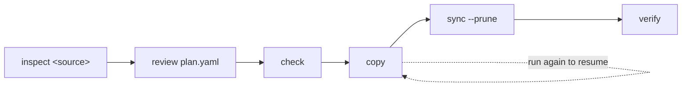

# to-weaviate

[](https://github.com/weaviate/to-weaviate/actions/workflows/ci.yml)
[](https://github.com/weaviate/to-weaviate/blob/main/LICENSE)
[](https://github.com/weaviate/to-weaviate/blob/main/pyproject.toml)

`to-weaviate` migrates collections from another vector database into
[Weaviate](https://weaviate.io).

> [!NOTE]
> Chroma is the only supported source. To ask for another one,
> [open an issue](https://github.com/weaviate/to-weaviate/issues/new).


The Weaviate team maintains it.

## Supported sources

| Source | Deployments | Inspect command | Guide |
|---|---|---|---|
| Chroma | Chroma Cloud, distributed Chroma, single-node Chroma, a Chroma directory on disk | `inspect chroma` | [Chroma](https://github.com/weaviate/to-weaviate/blob/main/docs/sources/chroma.md) |

## Features

- **Read-only on the source.** No command writes to it or deletes from it.
- **A plan you review first.** `inspect` drafts `plan.yaml`; nothing reaches
  Weaviate until you run `copy` or `sync`.
- **Safe to rerun.** A rerun of `copy` continues at the page where the last
  run stopped. Each object's UUID comes from its source id, so a rerun
  writes no duplicate.
- **Verified.** `verify` compares counts, ids, and a sample of records with
  their vectors, and writes a report.
- **No secrets in output.** Keys come from the environment, and no output or
  file holds one.

## Requirements & Installation

- Python 3.10 or newer.
- A Weaviate instance: a [Weaviate Cloud](https://console.weaviate.cloud)
  cluster, or a [server you run yourself](https://docs.weaviate.io/deploy).
  A free (sandbox) Weaviate Cloud cluster accepts only the index type
  `hfresh`; for one, run `inspect` with `--index hfresh`.
  [Weaviate target](https://github.com/weaviate/to-weaviate/blob/main/docs/weaviate.md) has the details.
- Read access to the source. See the [source guide](https://github.com/weaviate/to-weaviate/blob/main/docs/sources/README.md).

```bash
pip install to-weaviate
```

To run it without installing, use [uv](https://docs.astral.sh/uv/):

```bash
uvx to-weaviate --help
```

Each [GitHub release](https://github.com/weaviate/to-weaviate/releases) also
carries the wheel and the sdist of that version.

## Migration steps



1. Run `to-weaviate inspect <source>`. It reads the source and writes a
   draft `plan.yaml`.
2. Review the plan. Edit the names, types or vector settings you want to
   change.
3. Run `to-weaviate check`. It validates the plan against Weaviate and
   creates nothing.
4. Run `to-weaviate copy`. It creates the collections and copies the
   records. If it stops, run it again to resume. Some sources need the
   writes to them paused while `copy` and `sync` run; the "Writes during a
   copy" section of each [source guide](https://github.com/weaviate/to-weaviate/blob/main/docs/sources/README.md) says which.
5. Optional: run `to-weaviate sync` to write the records that are new or
   changed since the copy. Run it as often as you like before the last step.
6. Stop the writes to the source, then run `to-weaviate sync --prune`. It
   writes the records that are new or changed since the last run and
   deletes the objects whose source record is gone.
7. Run `to-weaviate verify`. It compares Weaviate with the source and writes
   `report.md`. When every check passes, switch your application to
   Weaviate.

Run `to-weaviate status` at any time to see the copy progress. It needs no
credentials. Every command uses one migration directory, `./.to-weaviate`
unless you pass `--dir`.

## Example

This example migrates one collection from Chroma Cloud to Weaviate Cloud.
It assumes:

- The Chroma Cloud collection is `support-articles`: 5,000 records with
  1536-dimension vectors.
- The Weaviate Cloud cluster is not a free (sandbox) cluster.
- The application does not write to the collection while `copy` and `sync`
  run. Chroma Cloud needs that.
- You run every command in one directory, and the settings are in a `.env`
  file there or exported.

For a server you run yourself, the [Chroma guide](https://github.com/weaviate/to-weaviate/blob/main/docs/sources/chroma.md)
and [Weaviate target](https://github.com/weaviate/to-weaviate/blob/main/docs/weaviate.md) list the settings.

### Configure

```dotenv
CHROMA_API_KEY=<Chroma Cloud API key>
WEAVIATE_URL=https://my-cluster.weaviate.cloud
WEAVIATE_API_KEY=<Weaviate API key>
```

`WEAVIATE_URL` and `WEAVIATE_API_KEY` are the URL and an API key of the
Weaviate Cloud cluster. Both are in the
[Weaviate Cloud console](https://console.weaviate.cloud). `CHROMA_API_KEY`
is a Chroma Cloud API key. The [Chroma guide](https://github.com/weaviate/to-weaviate/blob/main/docs/sources/chroma.md) lists
the other Chroma settings.

### Inspect and review the plan

```console
$ to-weaviate inspect chroma --collection support-articles
Inspecting Chroma at https://api.trychroma.com
support-articles -> Support_articles
  count: 5000
  dimension: 1536
  distance: cosine
  vectors: default (keep, no vectorizer)
Decisions:
  support-articles (vector_mode): No Weaviate vectorizer matches the source embedding function. Either supply query vectors from the application, or run inspect with --vectors embed to re-vectorize the documents in Weaviate.
Review .to-weaviate/plan.yaml, then run to-weaviate check.
```

Each entry of `.to-weaviate/plan.yaml` maps one source collection to one
Weaviate collection. An excerpt:

```yaml
collections:
- source:
    name: support-articles
    count: 5000
    dimension: 1536
  target:
    name: Support_articles
    vectors:
    - name: default
      mode: keep
      distance: cosine
    properties:
    - source_key: product
      name: product
      type: text
    - source_key: views
      name: views
      type: int
    - source_key: verified
      name: verified
      type: boolean
```

[The plan file](https://github.com/weaviate/to-weaviate/blob/main/docs/plan-file.md) lists the edits you can make.

### Check and copy

```console
$ to-weaviate check
Checking the target at https://my-cluster.weaviate.cloud
No errors, 0 warnings.

$ to-weaviate copy
Copying support-articles to Support_articles
Copied support-articles: 5000 records, 0 rejects
support-articles -> Support_articles: copied 5000 of 5000, rejects 0, done
Total: 5000 records
```

### Sync, verify and switch

Stop the writes to the source. Here the source gained 5 records, 5 changed
and 5 were deleted after the copy:

```console
$ to-weaviate sync --prune
Syncing support-articles to Support_articles
Synced support-articles to Support_articles: 10 records written, 4990 unchanged, 0 rejects, 5 stale, 5 deleted
support-articles -> Support_articles: copied 10, unchanged 4990, rejects 0, stale 5, deleted 5
Total: copied 10, unchanged 4990, rejects 0, stale 5, deleted 5

$ to-weaviate verify
Verifying support-articles in Support_articles
PASS Support_articles count: source count 5000, target count 5000
PASS Support_articles ids: missing 0, extra 0
PASS Support_articles records: sampled 300, compared 300, rejects skipped 0, differing 0
```

Now switch your application to Weaviate. Do not run `sync` against this
target afterwards: the source no longer holds the current data.

## Commands

| Command | What it does |
|---|---|
| `inspect <source>` | Reads the source collections and writes `inspect.json` and a draft `plan.yaml`. |
| `check` | Validates `plan.yaml` against Weaviate: names, types, vectorizer modules, provider keys, existing collections. Creates nothing. |
| `copy` | Creates the collections and copies the records. Run it again to resume or to copy new records. |
| `sync` | Writes the records that are new or changed since the copy. With `--prune`, deletes the objects whose source record is gone. |
| `verify` | Compares counts, ids and a sample of records, and writes `report.md` and `report.json`. |
| `status` | Shows the progress of each collection from the migration directory. |

Every command takes `--dir` and `--json`. With `--json`, stdout holds one
JSON document. The exit code names the class of failure, with and without
`--json`:

| Exit code | Meaning |
|---|---|
| 0 | Success |
| 1 | Rejected records, a failed verification, or stale objects above 10% that `sync --prune` left alone |
| 2 | A usage, plan, state or directory error, a request the source refused, or an unconfirmed first run into a collection that holds objects `sync --prune` would delete |
| 3 | A missing or refused credential |
| 4 | An unreachable server, a source that is compacting or still written to, or a deletion Weaviate did only partly |
| 5 | An internal error |

[Commands](https://github.com/weaviate/to-weaviate/blob/main/docs/commands.md#exit-codes) lists every error code.

## Documentation

| Page | Contents |
|---|---|
| [Commands](https://github.com/weaviate/to-weaviate/blob/main/docs/commands.md) | The options every source shares, the migration directory, resuming, sync and the cutover, rejects, JSON output, error codes |
| [The plan file](https://github.com/weaviate/to-weaviate/blob/main/docs/plan-file.md) | The fields of `plan.yaml`, the edits it allows, vector modes, index and quantizer settings |
| [Weaviate target](https://github.com/weaviate/to-weaviate/blob/main/docs/weaviate.md) | `WEAVIATE_*` settings, Weaviate Cloud and self-hosted servers, vectorizer keys |
| [Sources](https://github.com/weaviate/to-weaviate/blob/main/docs/sources/README.md) | One guide per source: settings, options, data mapping, limits |
| [Development](https://github.com/weaviate/to-weaviate/blob/main/docs/development/README.md) | Architecture, adding a source, testing, releases |

The [Weaviate documentation](https://docs.weaviate.io) explains how to search
the migrated collections.

## Getting help

Ask in the [Weaviate forum](https://forum.weaviate.io), or report a bug in
[GitHub issues](https://github.com/weaviate/to-weaviate/issues).

## Contributing

See [CONTRIBUTING.md](https://github.com/weaviate/to-weaviate/blob/main/CONTRIBUTING.md).

## License

BSD-3-Clause. See [LICENSE](https://github.com/weaviate/to-weaviate/blob/main/LICENSE).
