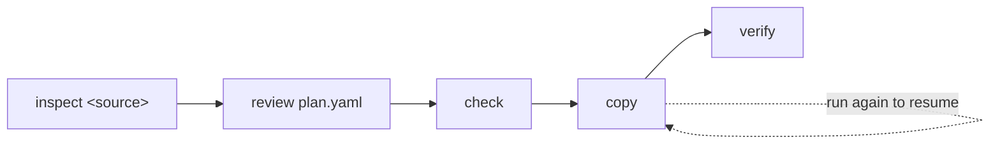

# to-weaviate

[](https://github.com/weaviate/to-weaviate/actions/workflows/ci.yml)
[](LICENSE)
[](pyproject.toml)

`to-weaviate` migrates collections from other vector databases into
[Weaviate](https://weaviate.io). It copies each record's id, vector, text and
metadata, resumes where it stopped, and checks the copy against the source.
It only reads from the source.

The Weaviate team maintains it.

## Supported sources

| Source | Deployments | Inspect command | Guide |
|---|---|---|---|
| Chroma | Chroma Cloud, distributed Chroma, single-node Chroma, a Chroma directory on disk | `inspect chroma` | [Chroma](docs/sources/chroma.md) |

To ask for another source, [open an issue](https://github.com/weaviate/to-weaviate/issues/new).

## Features

- **Read-only on the source.** No command writes to it or deletes from it.
- **A plan you review first.** `inspect` drafts `plan.yaml`; nothing reaches
  Weaviate until you run `copy`.
- **Your vectors or new ones.** Keep the source vectors, or let a Weaviate
  vectorizer embed the text.
- **Resumable.** A rerun of `copy` continues at the page where the last run
  stopped, and copies the records added since.
- **No duplicates.** Each object's UUID comes from its source id.
- **Verified.** `verify` compares counts, ids, and a sample of records with
  their vectors.
- **Built for scripts.** `--json` output and one exit code per failure class.
- **No secrets in output.** Keys come from the environment, and no output or
  file holds one.

## Install

You need Python 3.10 or newer.

```bash
pip install git+https://github.com/weaviate/to-weaviate
```

To run it without installing, use [uv](https://docs.astral.sh/uv/):

```bash
uvx --from git+https://github.com/weaviate/to-weaviate to-weaviate --help
```

## How a migration works



1. `to-weaviate inspect <source>` reads the source and writes a draft `plan.yaml`.
2. You review the plan and edit names, types or vector settings.
3. `to-weaviate check` validates the plan against Weaviate. It creates nothing.
4. `to-weaviate copy` creates the collections and copies the records.
5. `to-weaviate verify` compares Weaviate with the source and writes `report.md`.

`to-weaviate status` shows the copy progress at any time and needs no
credentials. Every command uses one migration directory, `./.to-weaviate`
unless you pass `--dir`.

## Quickstart

This example migrates one Chroma collection. Each
[source guide](docs/sources/README.md) lists the settings of its source.

Put the connection settings in a `.env` file in the directory where you run
the tool, or export them:

```dotenv
CHROMA_URL=http://localhost:8000
WEAVIATE_URL=https://my-cluster.weaviate.cloud
WEAVIATE_API_KEY=<Weaviate API key>
```

The output below comes from a run against a local Chroma on port 8001 and a
local Weaviate on port 8099.

Inspect the source:

```console
$ to-weaviate inspect chroma --collection docs-cosine
Inspecting Chroma at http://localhost:8001
docs-cosine -> Docs_cosine
  count: 700
  dimension: 8
  distance: cosine
  vectors: default (keep, no vectorizer)
Decisions:
  docs-cosine (vector_mode): No Weaviate vectorizer matches the source embedding function. Either supply query vectors from the application, or run inspect with --vectors embed to re-vectorize the documents in Weaviate.
  docs-cosine (mixed_types): key code has the types int: 650, text: 50; values are stored as text
Review .to-weaviate/plan.yaml, then run to-weaviate check.
```

Review `.to-weaviate/plan.yaml`. Each entry maps one source collection to
one Weaviate collection. An excerpt:

```yaml
collections:
- source:
    name: docs-cosine
    count: 700
  target:
    name: Docs_cosine
    vectors:
    - name: default
      mode: keep
      distance: cosine
    properties:
    - source_key: category
      name: category
      type: text
    - source_key: year
      name: year
      type: int
```

Then check the plan, copy, and verify:

```console
$ to-weaviate check
Checking the target at http://localhost:8099
warning coerced_keys Docs_cosine: key code has the types int: 650, text: 50; values are stored as text
No errors, 1 warning.

$ to-weaviate copy
Copying docs-cosine to Docs_cosine
Copied docs-cosine: 700 records, 0 rejects
warning coerced_keys Docs_cosine: key code has the types int: 650, text: 50; values are stored as text
docs-cosine -> Docs_cosine: copied 700 of 700, rejects 0, done
Total: 700 records

$ to-weaviate verify
Verifying docs-cosine in Docs_cosine
PASS Docs_cosine count: source count 700, target count 700
PASS Docs_cosine ids: missing 0, extra 0
PASS Docs_cosine records: sampled 300, compared 300, rejects skipped 0, differing 0
```

## Commands

| Command | What it does |
|---|---|
| `inspect <source>` | Reads the source collections and writes `inspect.json` and a draft `plan.yaml`. |
| `check` | Validates `plan.yaml` against Weaviate: names, types, vectorizer modules, provider keys, existing collections. Creates nothing. |
| `copy` | Creates the collections and copies the records. Run it again to resume or to copy new records. |
| `verify` | Compares counts, ids and a sample of records, and writes `report.md` and `report.json`. |
| `status` | Shows the progress of each collection from the migration directory. |

Every command takes `--dir` and `--json`. With `--json`, stdout holds one
JSON document. The exit code names the class of failure, with and without
`--json`: 1 for rejects or a failed verification, 2 for a usage or plan
error, 3 for credentials, 4 for an unreachable server or a source that is
compacting, 5 for an internal error. [Commands](docs/commands.md#exit-codes) lists every error code.

## Documentation

| Page | Contents |
|---|---|
| [Commands](docs/commands.md) | Every option, the migration directory, resuming, rejects, JSON output, error codes |
| [The plan file](docs/plan-file.md) | The fields of `plan.yaml`, the edits it allows, vector modes, index and quantizer settings |
| [Weaviate target](docs/weaviate.md) | `WEAVIATE_*` settings, Weaviate Cloud and self-hosted servers, vectorizer keys |
| [Sources](docs/sources/README.md) | One guide per source: settings, options, data mapping, limits |
| [Development](docs/development/README.md) | Architecture, adding a source, testing, releases |

The [Weaviate documentation](https://docs.weaviate.io) explains how to search
the migrated collections.

## Getting help

Ask in the [Weaviate forum](https://forum.weaviate.io), or report a bug in
[GitHub issues](https://github.com/weaviate/to-weaviate/issues).

## Contributing

See [CONTRIBUTING.md](CONTRIBUTING.md).

## License

BSD-3-Clause. See [LICENSE](LICENSE).
