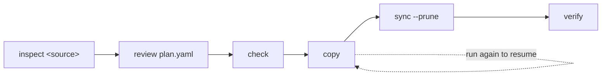

# to-weaviate

[](https://github.com/weaviate/to-weaviate/actions/workflows/ci.yml)
[](LICENSE)
[](pyproject.toml)

`to-weaviate` migrates collections from other vector databases into
[Weaviate](https://weaviate.io). It copies each record's id, vector, text and
metadata, resumes where it stopped, and checks the copy against the source.
It only reads from the source.


The Weaviate team maintains it.

## Supported sources

| Source | Deployments | Inspect command | Guide |
|---|---|---|---|
| Chroma | Chroma Cloud, distributed Chroma, single-node Chroma, a Chroma directory on disk | `inspect chroma` | [Chroma](docs/sources/chroma.md) |

To ask for another source, [open an issue](https://github.com/weaviate/to-weaviate/issues/new).

## Features

- **Read-only on the source.** No command writes to it or deletes from it.
- **A plan you review first.** `inspect` drafts `plan.yaml`; nothing reaches
  Weaviate until you run `copy` or `sync`.
- **Your vectors or new ones.** Keep the source vectors, or let a Weaviate
  vectorizer embed the text.
- **Resumable.** A rerun of `copy` continues at the page where the last run
  stopped, and copies the records added since.
- **A final sync.** `sync` writes the records that changed since the copy;
  `sync --prune` deletes the objects whose source record is gone.
- **No duplicates.** Each object's UUID comes from its source id.
- **Verified.** `verify` compares counts, ids, and a sample of records with
  their vectors.
- **Built for scripts.** `--json` output and one exit code per failure class.
- **No secrets in output.** Keys come from the environment, and no output or
  file holds one.

## Install

You need Python 3.10 or newer.

```bash
pip install git+https://github.com/weaviate/to-weaviate
```

To run it without installing, use [uv](https://docs.astral.sh/uv/):

```bash
uvx --from git+https://github.com/weaviate/to-weaviate to-weaviate --help
```

## How a migration works



1. `to-weaviate inspect <source>` reads the source and writes a draft `plan.yaml`.
2. You review the plan and edit names, types or vector settings.
3. `to-weaviate check` validates the plan against Weaviate. It creates nothing.
4. `to-weaviate copy` creates the collections and copies the records. Some
   sources need the writes to them paused while `copy` and `sync` run; the
   "Writes during a copy" section of each [source guide](docs/sources/README.md)
   says which.
5. Stop the writes to the source and run `to-weaviate sync --prune`. It
   writes the records that changed since the copy and deletes the objects
   whose source record is gone.
6. `to-weaviate verify` compares Weaviate with the source and writes
   `report.md`. Then switch your application to Weaviate.

`to-weaviate status` shows the copy progress at any time and needs no
credentials. Every command uses one migration directory, `./.to-weaviate`
unless you pass `--dir`.

## Quickstart

This example migrates the Chroma collection `support-articles` to Weaviate.
Replace the collection name and the settings with your own.
[`docs/demo/seed.py`](docs/demo/seed.py) creates this collection: 5,000
records with 1536-dimension vectors.

### Configure the source

`inspect` reads only the settings of its source. Put them in a `.env` file in
the directory where you run the tool, or export them:

```dotenv
CHROMA_URL=http://localhost:8001
```

Each [source guide](docs/sources/README.md) lists the settings of its source,
with an example for each deployment.

### Inspect

```console
$ to-weaviate inspect chroma --collection support-articles
Inspecting Chroma at http://localhost:8001
support-articles -> Support_articles
  count: 5000
  dimension: 1536
  distance: cosine
  vectors: default (keep, no vectorizer)
Decisions:
  support-articles (vector_mode): No Weaviate vectorizer matches the source embedding function. Either supply query vectors from the application, or run inspect with --vectors embed to re-vectorize the documents in Weaviate.
Review .to-weaviate/plan.yaml, then run to-weaviate check.
```

### Review the plan

Each entry of `.to-weaviate/plan.yaml` maps one source collection to one
Weaviate collection. An excerpt:

```yaml
collections:
- source:
    name: support-articles
    count: 5000
    dimension: 1536
  target:
    name: Support_articles
    vectors:
    - name: default
      mode: keep
      distance: cosine
    properties:
    - source_key: product
      name: product
      type: text
    - source_key: views
      name: views
      type: int
    - source_key: verified
      name: verified
      type: boolean
```

[The plan file](docs/plan-file.md) lists the edits you can make.

### Configure Weaviate

`check`, `copy`, `sync` and `verify` also need the Weaviate settings. For a Weaviate
server on your machine, add:

```dotenv
WEAVIATE_URL=http://localhost:8099
WEAVIATE_GRPC_URL=http://localhost:50099
WEAVIATE_API_KEY=<Weaviate API key>
```

Leave `WEAVIATE_API_KEY` unset for a server without authentication. For a
Weaviate Cloud cluster, set `WEAVIATE_URL` to the cluster URL and
`WEAVIATE_API_KEY` to an API key of the cluster from the
[Weaviate Cloud console](https://console.weaviate.cloud), and leave
`WEAVIATE_GRPC_URL` unset. [Weaviate target](docs/weaviate.md) has the
details.

### Check and copy

```console
$ to-weaviate check
Checking the target at http://localhost:8099
No errors, 0 warnings.

$ to-weaviate copy
Copying support-articles to Support_articles
Copied support-articles: 5000 records, 0 rejects
support-articles -> Support_articles: copied 5000 of 5000, rejects 0, done
Total: 5000 records
```

Some sources need the writes to them paused while `copy` and `sync` run; the
"Writes during a copy" section of each [source guide](docs/sources/README.md)
says which.

### Sync, verify and switch

Stop the writes to the source. `sync --prune` then writes the records that
are new or changed since the copy and deletes the objects whose source
record is gone. Here the source gained 5 records, 5 changed and 5 were
deleted after the copy:

```console
$ to-weaviate sync --prune
Syncing support-articles to Support_articles
Synced support-articles to Support_articles: 10 records written, 4990 unchanged, 0 rejects, 5 stale, 5 deleted
support-articles -> Support_articles: copied 10, unchanged 4990, rejects 0, stale 5, deleted 5
Total: copied 10, unchanged 4990, rejects 0, stale 5, deleted 5

$ to-weaviate verify
Verifying support-articles in Support_articles
PASS Support_articles count: source count 5000, target count 5000
PASS Support_articles ids: missing 0, extra 0
PASS Support_articles records: sampled 300, compared 300, rejects skipped 0, differing 0
```

Now switch your application to Weaviate. Do not run `sync` against this
target afterwards: the source no longer holds the current data.

With both servers on the machine that ran the tool, `copy` took 4.3 s,
`sync --prune` 4.2 s and `verify` 1.0 s.

## Commands

| Command | What it does |
|---|---|
| `inspect <source>` | Reads the source collections and writes `inspect.json` and a draft `plan.yaml`. |
| `check` | Validates `plan.yaml` against Weaviate: names, types, vectorizer modules, provider keys, existing collections. Creates nothing. |
| `copy` | Creates the collections and copies the records. Run it again to resume or to copy new records. |
| `sync` | Writes the records that are new or changed since the copy. With `--prune`, deletes the objects whose source record is gone. |
| `verify` | Compares counts, ids and a sample of records, and writes `report.md` and `report.json`. |
| `status` | Shows the progress of each collection from the migration directory. |

Every command takes `--dir` and `--json`. With `--json`, stdout holds one
JSON document. The exit code names the class of failure, with and without
`--json`:

| Exit code | Meaning |
|---|---|
| 0 | Success |
| 1 | Rejected records, a failed verification, or stale objects above 10% that `sync --prune` left alone |
| 2 | A usage, plan, state or directory error |
| 3 | A missing or refused credential |
| 4 | An unreachable server, a source that is compacting or still written to, or a deletion Weaviate did only partly |
| 5 | An internal error |

[Commands](docs/commands.md#exit-codes) lists every error code.

## Documentation

| Page | Contents |
|---|---|
| [Commands](docs/commands.md) | The options every source shares, the migration directory, resuming, sync and the cutover, rejects, JSON output, error codes |
| [The plan file](docs/plan-file.md) | The fields of `plan.yaml`, the edits it allows, vector modes, index and quantizer settings |
| [Weaviate target](docs/weaviate.md) | `WEAVIATE_*` settings, Weaviate Cloud and self-hosted servers, vectorizer keys |
| [Sources](docs/sources/README.md) | One guide per source: settings, options, data mapping, limits |
| [Development](docs/development/README.md) | Architecture, adding a source, testing, releases |

The [Weaviate documentation](https://docs.weaviate.io) explains how to search
the migrated collections.

## Getting help

Ask in the [Weaviate forum](https://forum.weaviate.io), or report a bug in
[GitHub issues](https://github.com/weaviate/to-weaviate/issues).

## Contributing

See [CONTRIBUTING.md](CONTRIBUTING.md).

## License

BSD-3-Clause. See [LICENSE](LICENSE).
