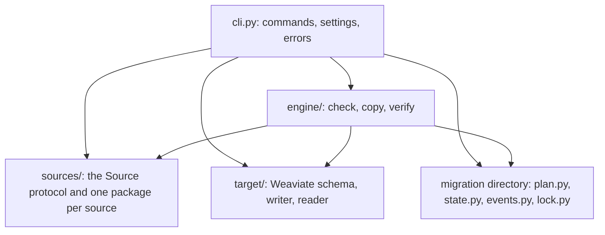

# Architecture

`to-weaviate` is a Python package with a [Typer](https://typer.tiangolo.com)
command-line interface. The entry point is `to_weaviate.cli:app`.

## Layers

An arrow means "calls". Every layer imports the types of `plan.py` and
`sources/base.py`, and `state.py` stores the `Reject` type of
`target/writer.py`.

- `cli.py` parses a command, reads the settings, builds the source and the
  Weaviate clients, and maps every exception to an error code.
- `engine/` runs copy and verify through the `Source` protocol, and computes
  the check findings from the plan and `inspect.json`. It imports no source
  package.
- `sources/` reads a source database. `sources/base.py` defines the protocol;
  `sources/chroma/` implements it.
- `target/` talks to Weaviate through the
  [Weaviate Python client](https://github.com/weaviate/weaviate-python-client).
- The migration directory holds the plan, the copy state, the events and the
  lock.

## Modules

| Module | Responsibility |
|---|---|
| `cli.py` | The commands; maps exceptions to `CliError`; loads `plan.yaml` and `inspect.json`; checks the state and the target before a copy |
| `settings.py` | `load_env` (`.env` under the environment), the source and Weaviate settings, URL validation, `API_KEY_MAP` |
| `output.py` | `ERROR_EXIT` (error code to exit code), JSON and text output, secret redaction |
| `plan.py` | The plan model, `draft_plan`, `load_plan`, `save_plan`, and the index and quantizer rules |
| `state.py` | `state.sqlite`: read positions, rejects, recorded targets, quantizer updates |
| `events.py` | `events.jsonl` |
| `lock.py` | `copy.lock` |
| `retry.py` | `with_retry`: 7 attempts, random delays up to 30 s |
| `naming.py` | Weaviate's rules for collection, property and tenant names |
| `types.py` | Metadata value to Weaviate type, and the conversion of values |
| `ids.py` | `to_uuid`: source id to object UUID |
| `engine/check.py` | Findings from the plan and `inspect.json`: entries, names, the `source_id` property, types, distances, vectorizer options, unmapped keys, quantizer training. `module_findings` for the enabled modules, `provider_keys` for the keys a plan needs. |
| `engine/copy.py` | `copy_collection`: the partitioned, threaded, resumable copy and the tail of new records |
| `engine/verify.py` | The `count`, `ids` and `records` checks, and the report |
| `sources/base.py` | The `Source` protocol and the types `SourceCollection`, `FieldStats`, `Record`, `Partition`, `Page` |
| `target/connect.py` | Weaviate Cloud or custom connection, from the settings |
| `target/schema.py` | Creates collections from the plan, compares an existing collection with it, updates quantizers, classifies transient errors |
| `target/writer.py` | Record to Weaviate object or reject; chunks of at most 4 MiB by estimated size, an object above that alone, with retries |
| `target/reader.py` | Reads objects back for `verify` |

## How each command runs

**`inspect <source>`**: `cli.py` builds the source from its settings and
calls `Source.inspect`, which returns one `SourceCollection` per collection.
`plan.draft_plan` turns them into a `Plan`, with the source's own mapper from
embedding configuration to vectorizer. `cli.py` writes `inspect.json` and
`plan.yaml`.

**`check`**: `cli.py` loads the plan and `inspect.json`. It stops with
`missing_credential` before it connects when the environment lacks a
provider key that a planned vectorizer needs. `engine/check.py` returns
findings from the plan and `inspect.json`, and from the modules the target
has enabled. `cli.py` adds the differences that `target/schema.py` finds in
existing collections, and a `missing_property` warning for each planned
property that an existing collection lacks. `check` writes nothing.

**`copy`**:

1. `cli.py` runs the plan findings of `check`, the source check and the
   provider-key check. It then takes `copy.lock` and checks the enabled
   modules and the recorded targets in `state.sqlite`.
2. `target/schema.ensure_collection` creates each target collection, or
   compares the existing one with the plan and adds missing properties.
3. For each plan entry, `engine/copy.copy_collection`:
   - calls `Source.wait_compacted`, which returns a state, or `None` for a
     source without compaction;
   - splits the collection with `Source.partitions`, and reads the pending
     partitions with `Source.read` in a pool of `--parallelism` threads, one
     task per partition;
   - converts each page with `target/writer` and writes it, then advances
     the partition's position in `state.sqlite`;
   - reads `Source.count` again and copies the records added since in a tail
     partition;
   - compares `Source.compaction_state` with the state from the wait, and
     raises `SourceChanged` when they differ.

   After `copy_collection` returns, `copy` enables the entry's trained
   quantizers and records that in `state.sqlite`. Then the next entry
   starts.

**`verify`**: `engine/verify.py` compares `Source.count` with the object
count, diffs `Source.ids` against the target ids in a scratch sqlite file,
and compares `Source.sample` records with the objects that `target/reader`
reads. It writes `report.md` and `report.json`.

**`status`**: reads `plan.yaml` and `state.sqlite`.

## The `Source` protocol

`Source` in `sources/base.py` is a `typing.Protocol`. mypy checks that a
source conforms; nothing checks it at run time.

| Member | Called by |
|---|---|
| `inspect(namespaces, collections, sample_pages)` | `inspect`. The result goes to `inspect.json` and into the draft plan. |
| `partitions(collection, parallelism)` | `copy`, once per collection in every run. `state.sqlite` keeps the partitions of the first run. |
| `read(collection, partition, cursor, with_vectors)` | `copy`, in a pool of `--parallelism` threads, one task per partition. Returns a `Page`; `next_cursor` `None` ends the partition. |
| `ids_at(collection, offset, limit)`, `page_size` | `copy`, after the stored partitions finish: one call checks that no record before the end moved. After a move, `copy` reads ids backwards, `page_size` at a time, to find where the tail starts. |
| `count(collection)` | `copy` (the live total and the tail) and `verify` (the `count` check). |
| `ids(collection)` | `verify`, the `ids` check. |
| `sample(collection, size, rng, with_vectors)` | `verify`, the `records` check. |
| `wait_compacted(collection, waiting)`, `compaction_state(collection)` | `copy` and `verify`, before the first page and after the last read. |
| `tenant`, `searched_namespaces` | `inspect`, for the message when it finds no collection. |
| `namespaces()` | The source's own `inspect`, when no namespace is given. |
| `name`, `capabilities`, `vector_search`, `filter_equal` | Declared by the protocol; no command calls them. |

### What the copy engine expects of a source

| Rule | Why |
|---|---|
| `partitions` returns ranges of decimal offsets that cover `[0, count)`, each with a `stop`, and `[]` for an empty collection. | `engine/copy.py` parses the offsets to know what is copied. |
| Cursors are decimal offsets. A tail partition (`stop` is `None`) reads until an empty page. | The tail starts where the last run ended. |
| Records come in insertion order. A deletion moves later records one position down; an addition goes after the last record. | Resuming and finding new records depend on this order. |
| `read` is safe to call from up to 8 threads for different partitions of one collection. | `copy --parallelism` runs up to 8 reads of one collection at once. |
| A vector that holds a non-number arrives as NaN. | The engine turns such a record into a reject. |
| `count` equals the number of records `read` returns. | `verify`'s `count` check compares it with Weaviate. |
| `inspect` lists every metadata key in `fields`. | A key missing from the plan makes each record that has it a reject. |
| Metadata values are `bool`, `int`, `float`, `str`, `None`, or lists of one of these. | `types.py` maps and converts only these. |
| Errors are the source's own exception class, with a `status` and an optional `hint`. | `cli.py` maps them to `auth_failed` or `source_unreachable`. |
| Every `SourceCollection` field survives `dataclasses.asdict` to JSON and back. | `inspect.json` stores it. |

A source that pages with an opaque cursor, such as a token or the last id,
breaks the offset rules. Supporting one means changing the resume and tail
logic in `engine/copy.py`.

## Rules every change keeps

- No command writes to the source.
- A read position advances only after Weaviate stored its page.
- An object's UUID depends only on its source id (`ids.py`), so writing a
  page twice adds nothing.
- The tool reads credentials only from the environment or `.env`. Printed
  output redacts the values of `SECRET_VARIABLES` (`output.py`) and the
  passwords and tokens in `URL_VARIABLES` (`settings.py`). A new secret
  variable goes into one of those lists.
- Files are not redacted. They store URLs without userinfo, query and
  fragment (`stored_url` in `settings.py`), and only the embedding keys that
  the source lists (`stored_embedding` in `sources/chroma/mapping.py`). A new
  file writer must store the same forms.
- With `--json`, stdout holds exactly one JSON document, unless the parser
  refuses an option value or Ctrl-C stops the command.
- Every error code has one exit code, in `ERROR_EXIT` (`output.py`).
